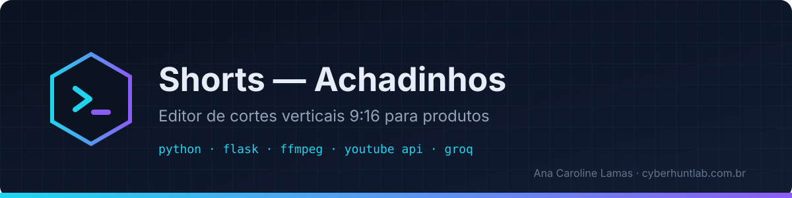

<p align="center"></p>

# Shorts — Os Achadinhos da Shopee: editor de cortes verticais 9:16

Aplicação web privada em **Python/Flask** para criar **vídeos curtos verticais (9:16)** de produtos de afiliado. Ela organiza projetos por produto, sugere palavras-chave (localmente ou com **Groq**), pesquisa referências públicas na **YouTube Data API v3** e corta trechos de vídeos **próprios ou licenciados** com **FFmpeg**, em 1080×1920. Cada corte só é exportado depois de passar por uma lista obrigatória de revisão humana.

## Recursos

- **Login** com usuário e senha definidos por variáveis de ambiente.
- **Projetos por produto**: cadastro, upload de vídeo (limite configurável) e histórico de cortes.
- **Palavras-chave**: geração local simples ou expandida com a API do Groq (opcional).
- **Pesquisa de referências**: título, canal, link e miniatura via YouTube Data API v3. A aplicação **não baixa** vídeos do YouTube.
- **Corte vertical com FFmpeg**: redimensiona e recorta para 1080×1920 e mantém o áudio original.
- **Checklist obrigatório** antes de exportar o MP4:
  - produto corresponde ao anúncio;
  - sem marca d'água nem logotipo de terceiros;
  - cena nítida e contextualizada;
  - sem violência ou conteúdo impróprio;
  - direitos de uso confirmados.
- **Chaves de API cifradas** no SQLite com `cryptography` (Fernet), derivadas de `APP_SECRET`, e cadastradas pelo painel.
- **Endpoint de saúde** em `/health`.

## Instalação

Requisitos: **Python 3.10+**, **FFmpeg** e **ffprobe** (com `libx264` e `aac`).

```bash
git clone https://github.com/ticarollamas-arch/Shorts-Achadinhos-Shopee.git
cd Shorts-Achadinhos-Shopee
pip install -r requirements.txt
cp .env.example .env
```

| Variável | Uso |
|---|---|
| `APP_SECRET` | Chave longa e aleatória (sessão e cifra das chaves de API) |
| `ADMIN_USER` / `ADMIN_PASSWORD` | Acesso ao painel; troque os valores padrão |
| `MAX_UPLOAD_MB` | Tamanho máximo de upload (padrão 500) |
| `PORT` | Porta do servidor (padrão 5000) |

## Como usar

```bash
python app.py                      # desenvolvimento
gunicorn app:app -b 0.0.0.0:5000   # produção
```

1. Entre no painel e, em **Configurações**, cadastre as chaves `YOUTUBE_API_KEY` e `GROQ_API_KEY` (ambas opcionais).
2. Crie um projeto para o produto, pesquise referências e envie um vídeo que você tem direito de usar.
3. Defina o trecho, marque os seis critérios e exporte o MP4 vertical.

### Deploy

- **Railway**: o `Dockerfile` já instala o FFmpeg. Crie volumes em `/app/data` e `/app/storage` e configure as variáveis.
- **cPanel (Setup Python App / Passenger)**: startup `passenger_wsgi.py`, entry point `application`. A renderização depende de o provedor liberar FFmpeg, subprocessos e limites de CPU e tempo; se não liberar, mantenha o painel no cPanel e processe os vídeos em Railway ou VPS.

## Limitações

- A revisão de logotipos, marcas d'água e violência é humana; ainda não há visão computacional, OCR nem legendas automáticas.
- Não gera voz nem música.

## Tecnologias

Python 3 · Flask · Gunicorn · SQLite · cryptography (Fernet) · FFmpeg · YouTube Data API v3 · Groq API · Docker · Railway · Passenger/cPanel

## Licença

Distribuído sob a licença MIT. Veja [LICENSE](LICENSE). Marcas citadas pertencem aos seus titulares.
